<p align="center">
  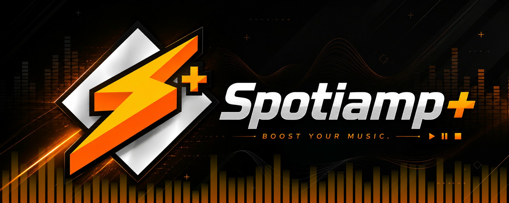
</p>

<p align="center">
  <a href="../../releases/latest"></a>
  <a href="../../releases"></a>
  
  <a href="https://discord.gg/8Rq5Xycny4"></a>
  <a href="https://fdeox.github.io/spotiamp-plus/"></a>
</p>

Spotiamp+ is Winamp for Spotify. The player, the equalizer, the playlist and
the rest of the windows look and work the way they did in Winamp, they wear
real Winamp skins (the classic ones and Winamp 5's modern ones), and they play
your Spotify account natively, without a browser. Your own music files and
internet radio go in the same playlist.

<p align="center">
  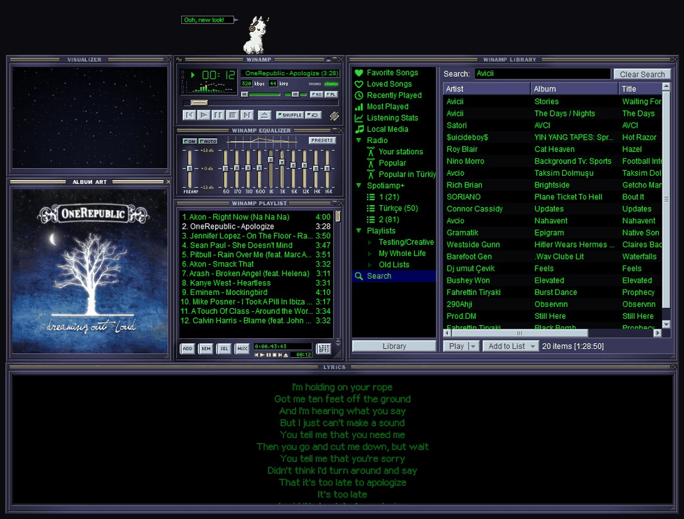
</p>

Spotify Premium streams directly, through
[librespot](https://github.com/librespot-org/librespot). With a Free account,
Spotiamp+ runs in Free Mode: it becomes the Winamp face of the official Spotify
app and drives it, lyrics and album art included. A Premium account Spotify
won't serve to librespot can play through Spotify Soloist, Spotify's own
player: Spotiamp+ offers to set it up when it happens. Signing in always
happens on Spotify's own page.

## Music

The Library window has your Spotify playlists (in their folders, as Spotify
keeps them), your Liked Songs as *Favorite Songs*, what you've played recently
and most, and a search of the whole catalogue. Double-click a search result to
add it to the playlist, drag songs or whole playlists across, pin the lists
you use most. In the playlist, **F** loves a song, **Q** plays the selected one
next and **J** finds a song by name; right-click a song for an instant mix of
twenty more like it. Playback is Ogg Vorbis at 320 kbps and gapless, it picks
up where you left off, and it reconnects on its own if Spotify drops the
session.

Your own files play right next to Spotify: MP3, FLAC, M4A (AAC and Apple
Lossless), WAV, OGG, Opus and WMA, with their tags, through the same equalizer
and visualizers. Press **O** for files or **Shift+O** for a folder, or drag
them in from Explorer. The Library is Winamp 5's Media Library, in every
skin: add your music folders to *Local Media* and they're listed the way
Winamp listed them, with artist and album filters, track numbers, years,
genres, ratings and play counts, ready to sort and search. New files show up
by themselves, and a list of tens of thousands scrolls like one of ten. All
of this works in Free Mode as well.

For radio, the Library searches thousands of stations by name or genre and
shows the most listened ones, everywhere or in your country. **Ctrl+L** opens
any stream link (SHOUTcast, Icecast, HLS, `.pls`, `.m3u`) or a Spotify song,
album or playlist. Stations play in full quality, HE-AAC and Opus included,
with the name of the song they're on.

| Local Media | Radio |
| :---------: | :---: |
| 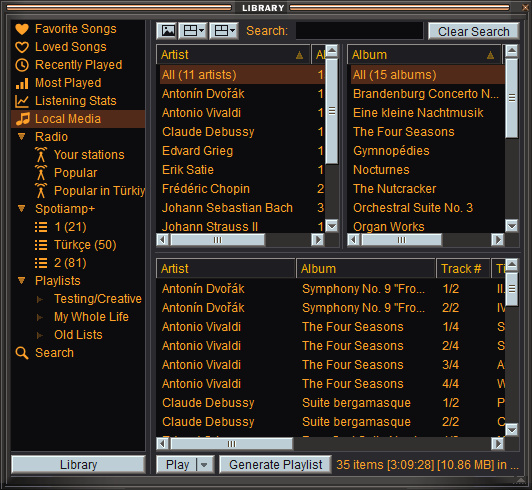 | 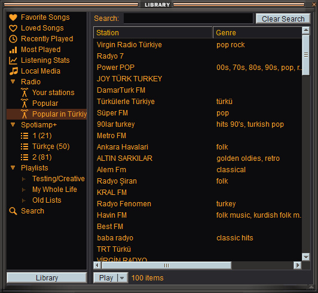 |

Connect your Last.fm (right-click, *Last.fm*) and what you play is scrobbled
once half of it has played, offline too: the scrobbles wait and go out later.
Songs you love can be loved on Last.fm as well.

## Skins

Right-click, *Skins*. Classic comes in four colours, there's Spotiamp+'s own
orange skin, and six classic Winamp skins are built in: the *Classified* series
by [Victhor](https://victhor.deviantart.com/) and the Sony and Nucleo
hardware-style ones (all rights stay with their authors). The Skin Museum
opens inside the app with thousands more from the
[Winamp Skin Museum](https://skins.webamp.org/): one click puts a skin on, a
star keeps it. Any `.wsz` file loads from disk too.

A skin covers every window, the Library included, the way Winamp did it: its
cursors, its window shapes, its title bars written in its own letters, its
visualizer colours and, if you want, its font.

| Spotiamp+ | Bento Classified | Winamp3 Classified | Winamp5 Classified |
| :-------: | :--------------: | :----------------: | :----------------: |
| 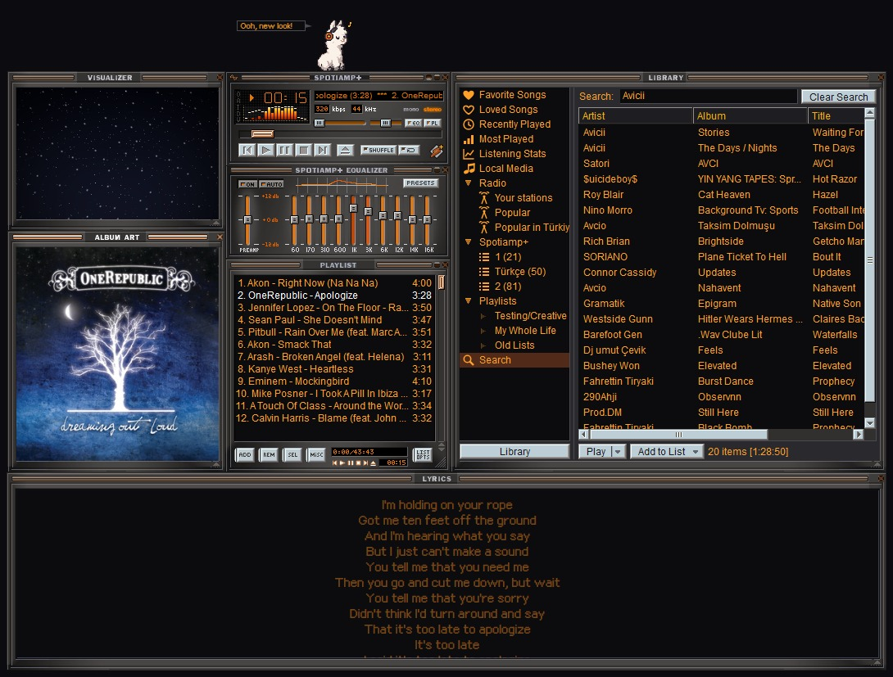 | 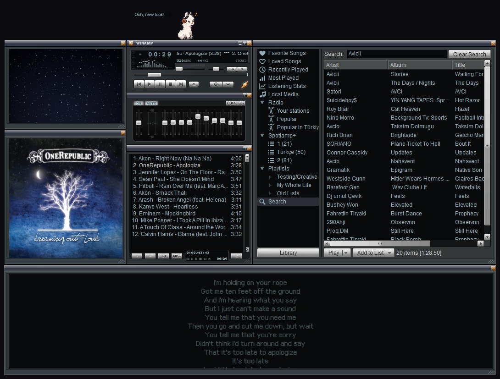 | 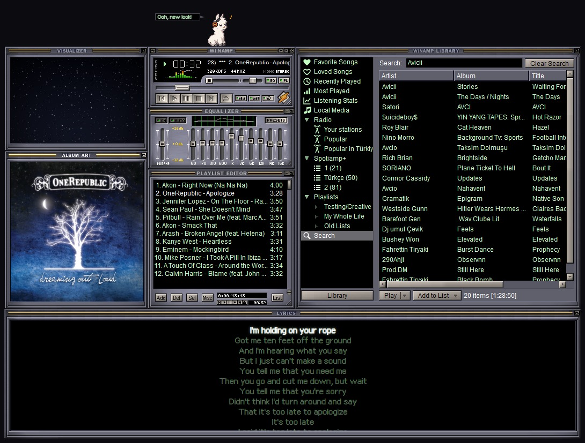 | 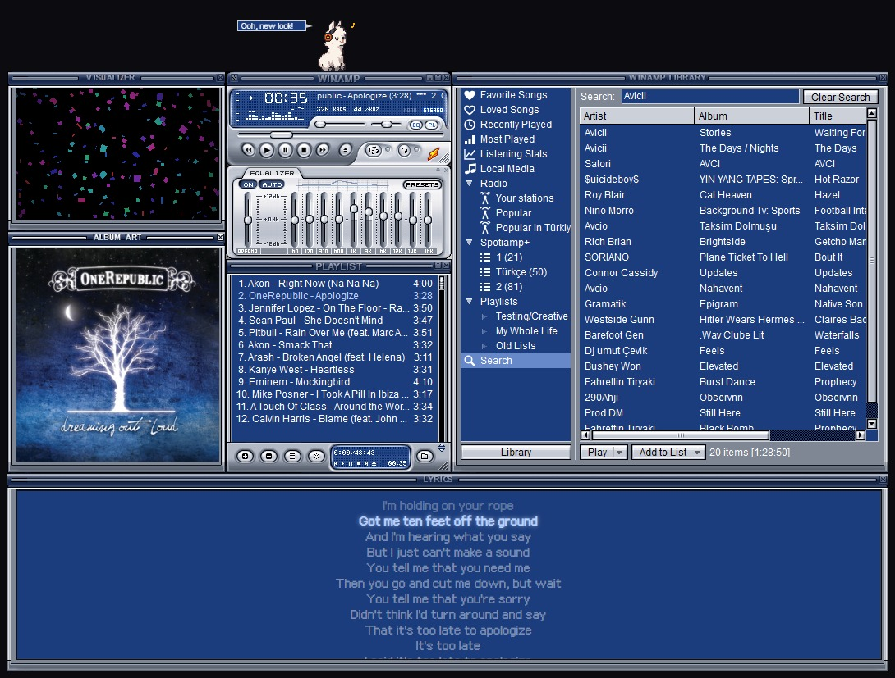 |

| Nucleo NLog | Sony CDX-MP3 | Sony Esprit V2 | Classic |
| :---------: | :----------: | :------------: | :-----: |
|  |  |  | 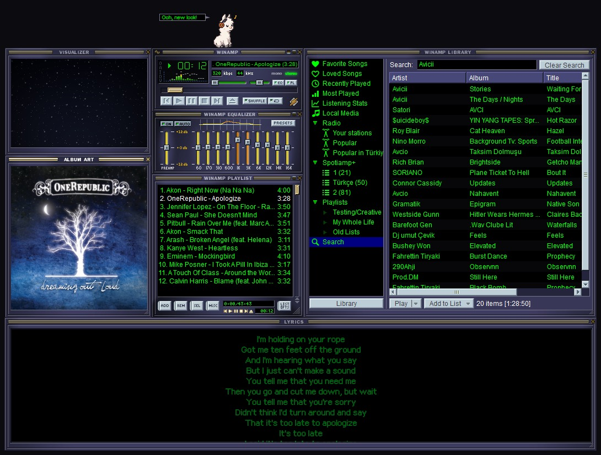 |

| Cherry | Amber | Emerald |
| :----: | :---: | :-----: |
| 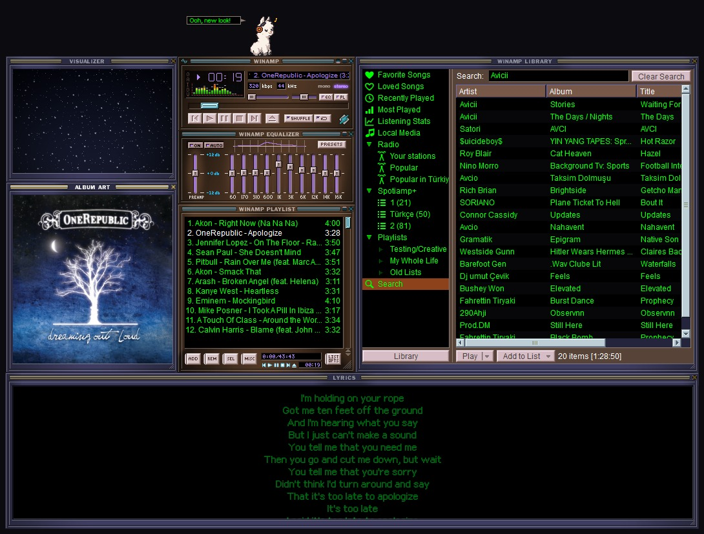 | 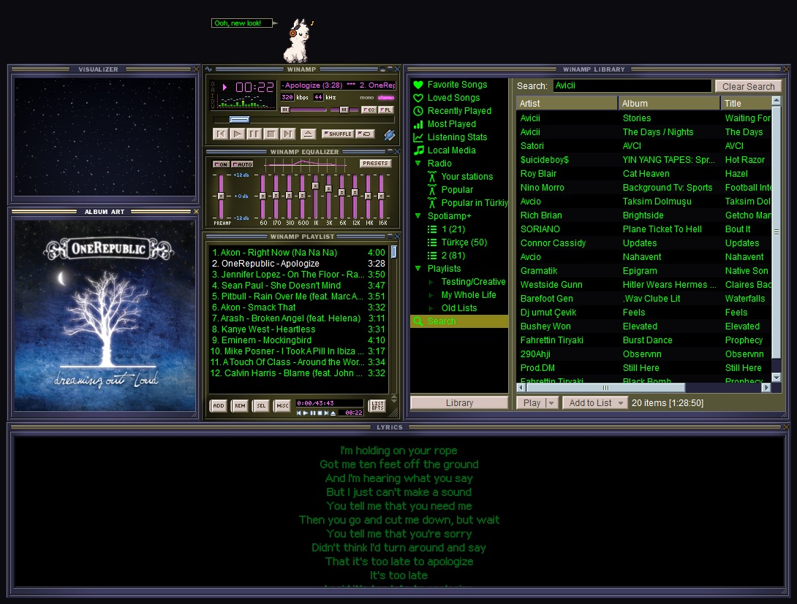 | 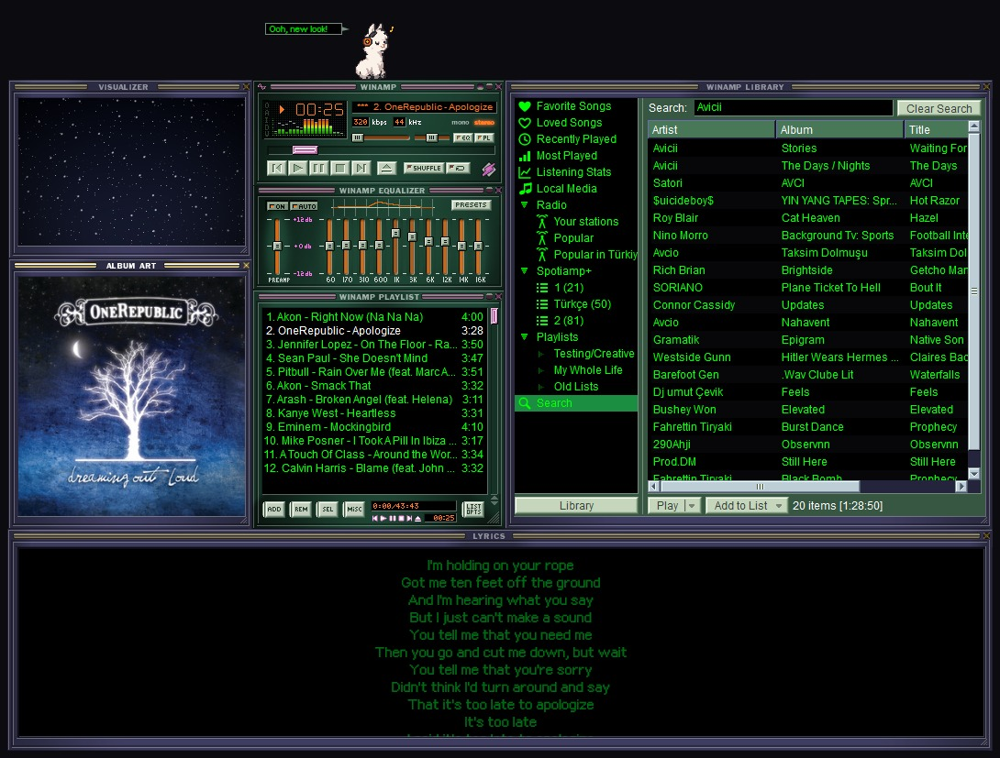 |

### Winamp 5's modern skins

Spotiamp+ also wears the modern skins made for Winamp 3 and 5 (`.wal`):
Winamp Modern, Bento, Big Bento and the thousands that followed. They bring
their own windows, shapes and scripts, and every part of them works: the
buttons, the seek bar and volume, the equalizer, the playlist, the album art
and the visualizers. Spotiamp+'s windows go where Winamp put its own. The
Library opens inside the skin's Media Library (in Big Bento it fills the main
window), the visualizer in the skin's visualizer window, and the lyrics and the
rest in the skin's own frame, in its colours. Lala sits on top of whichever
skin you wear.

Find them in the Skin Museum's *Modern* tab, or load one with *Skins, Load a
modern skin (.wal)*. Picking a classic skin brings the classic windows back.

<p align="center">
  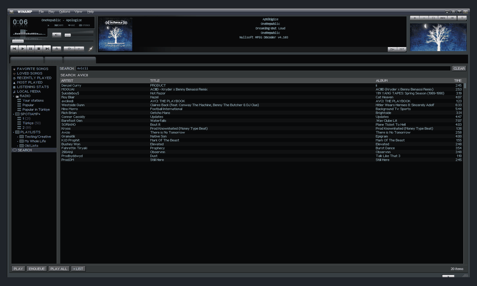
</p>

## Visualizers

MilkDrop runs for real, drawn by
[projectM](https://github.com/projectM-visualizer/projectm). 537 presets come
with it, 183 of them by Incubo_ (Se7enSlasher) and three endless underground
trips of our own in the spirit of Geiss' Monkey, and presets made for his
BeatDrop work too. In the visualizer window, **M** turns MilkDrop on, **L**
opens the preset list (search it, keep your favourites), a click moves to the
next preset, PIN holds one and a double-click goes fullscreen. Your own `.milk`
files and textures have a folder of their own.

Without MilkDrop the window has a hundred more patterns of its own: spectrum
analysers, VU meters, a spectrogram, a spinning record and more, changing on
a click, on a timer or with every song. The main window keeps Winamp's spectrum
and oscilloscope, in the skin's colours.

| MilkDrop, moving with the music | Four of its presets |
| :-----------------------------: | :-----------------: |
|  | 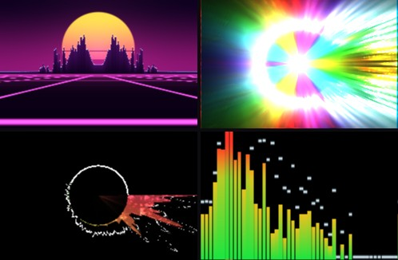 |

## Lala

<p align="center">
  
</p>

Lala is a small llama who lives on your player. She dances while the music
plays, naps when it stops and wakes up when you pat her. Now and then she has
something to say (a fact about the song, your listening streak, a tip), and
when she gets bored she wanders over to your other windows. Drag her along the
edge, double-click her for a walk, right-click her to change her size, quiet
her or send her away.

Her wardrobe has twenty outfits, from sneakers and a cap to a hoodie, a guitar
and a crown, and each one opens with one of your listening badges. On
Halloween she dresses as a witch, and over New Year she wears a Santa hat.

## Lyrics, album art, equalizer and stats

Lyrics follow the song line by line, and clicking a line jumps there. Spotify
songs get Spotify's own; your files, radio songs and Free Mode get theirs from
[LRCLIB](https://lrclib.net). The album art window shows the cover and docks
with the rest.

The equalizer is Winamp's, with a real ten-band DSP behind it, a preamp,
presets and `.EQF` files. Turn on AUTO and a curve saved for a song or an
artist comes back every time they play.

Listening stats keep the time you've listened, your top songs and artists, your
streak and the hours you listen at, along with 48 badges to unlock and a card
to share. Every December, Rewind looks back on your year.

| Equalizer | Album art | Visualizer |
| :-------: | :-------: | :--------: |
| 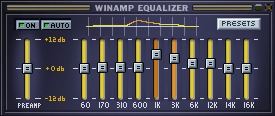 | 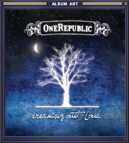 | 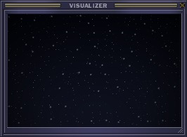 |

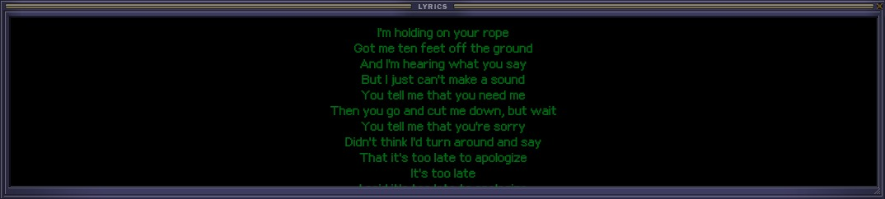

<details>
<summary><b>Everything else</b></summary>

- Windows dock to the main window and move with it, and any window rolls up to
  a strip (windowshade).
- Every window scales to 1x, 1.5x, 2x or 3x and stays sharp at any display
  scaling. Ctrl+D switches to 2x.
- Stop after the current song (Ctrl+V), jump to a time (Ctrl+J), shuffle, and
  repeat for the list or one song. A song is never listed twice.
- `.m3u` playlists open and save with local files, Spotify songs and radio
  stations in order.
- Right-click a song to play it next, love it, add it to a list, copy its link
  or show the file in its folder.
- Audio quality (320, 160 or 96 kbps), volume normalization and the output
  device are under *Audio*.
- Winamp's global hotkeys: Ctrl+Alt with Insert, Home, End, Page Up, Page Down
  and the arrows work from any program, once you turn them on.
- One window in Alt+Tab and on the taskbar, like Winamp. Alt+E and Alt+G show
  and hide the playlist and the equalizer from any window.
- An on-screen display with the new song and its cover, and taskbar extras: the
  song on the taskbar button, progress across it, and previous, play and next
  under its thumbnail. Both are optional.
- The Now Playing card: a picture of the player and the song, ready to paste.
- A sleep timer, media keys and headset buttons, and Discord Rich Presence with
  the song, its cover and a progress bar.
- Your window layout comes back the way you left it.
- A signed built-in updater, and a *What's new* window after each update.
- *Help, Copy diagnostic info* for bug reports, and *Log out* at the bottom of
  the menu to switch accounts.

</details>

## Install

1. Download the installer from the [latest release](../../releases/latest).
2. Run it. Windows SmartScreen may warn about an unknown publisher: choose
   *More info*, then *Run anyway*.
3. Start Spotiamp+ and sign in with Spotify. Premium streams directly, Free
   runs in Free Mode.

Updates come through right-click, *Help*, *Check for updates*. Windows 10 and
11 (x64) for now.

<details>
<summary><b>Keyboard shortcuts</b></summary>

These work in the main window and in every other window. In the Library,
typing searches, so only `Ctrl+D`, `Ctrl+V`, `Ctrl+J`, `Ctrl+L` and `F1` work
there. The right-click menu shows each key next to its command, and `F1` opens
the whole list.

| Key | Action | Key | Action |
| --- | --- | --- | --- |
| `Z` `X` `C` `V` `B` | previous, play, pause, stop, next | `Space` | play or pause |
| `Up` `Down`, mouse wheel | volume | `Left` `Right` | seek 5 seconds |
| `S` | shuffle | `R` | repeat (off, all, one) |
| `J` | jump to a song | `Q` | play the selected song next |
| `F` | love the song | `Ctrl+V` | stop after the current song |
| `L` | open the Library | `O`, `Shift+O` | add files, add a folder |
| `Ctrl+D` | everything twice as big | `F1` | all the shortcuts |
| `Ctrl+J` | jump to a time | `Ctrl+L` | open a Spotify link or a station |
| `Alt+E` | show or hide the playlist | `Alt+G` | show or hide the equalizer |

In the playlist, `Ctrl+A` selects everything, `Delete` removes, `Enter` plays
and the arrows move the selection (`Shift` extends it, `Alt` with the arrows
moves the songs). Letters are shortcuts there, so press `J` and type part of a
name to find a song. In the Library, start typing to jump to the first match.

With global hotkeys on (*Windows* menu): `Ctrl+Alt` with `Insert`, `Home` and
`End` play, pause and stop, `Page Up` and `Page Down` go back and forward, the
up and down arrows change the volume and left and right jump 5 seconds, from
any program.

In the visualizer, a click changes the pattern, a double-click goes fullscreen
and `Esc` comes back. `M` turns MilkDrop on and off; with it on, `L` opens the
preset list.

</details>

<details>
<summary><b>Build from source</b></summary>

You need Rust (stable), Node.js and the
[Tauri 2 prerequisites](https://v2.tauri.app/start/prerequisites/) for your
platform (on Windows, the Visual C++ Build Tools and WebView2).

```bash
npm install
npm run tauri dev      # run in development
npm run tauri build    # build an installer (src-tauri/target/release/bundle)
```

</details>

---

<sub>[MIT License](LICENSE) (Lala's art and animations: © fdeox, all rights reserved, see [their license](src/lib/mascot/LICENSE.md)) · [Privacy](PRIVACY.md) · based on [tedsteen/Spotiamp](https://github.com/tedsteen/Spotiamp) · modern skins drawn by [Webamp Modern](https://github.com/captbaritone/webamp) (MIT), ClassicPro skins by Skin Consortium's ClassicPro engine (BSD) · MilkDrop by [projectM](https://github.com/projectM-visualizer/projectm) (LGPL-2.1), presets and textures by their authors ([credits](src-tauri/presets/CREDITS.txt)) · AAC decoding by [rusty_aac](https://crates.io/crates/rusty_aac) (Apache-2.0) · Opus decoding by [opus-decoder](https://crates.io/crates/opus-decoder) (MIT) · lyrics for your own songs and radio from [LRCLIB](https://lrclib.net) · Spotify Soloist downloaded from Spotify when you set it up · not affiliated with Winamp or Spotify</sub>
