<p align="center">
  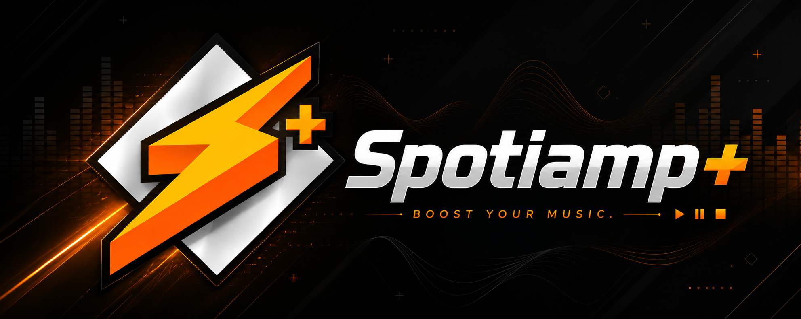
</p>

<p align="center">
  <a href="../../releases/latest"></a>
  <a href="../../releases"></a>
  
  <a href="https://discord.gg/8Rq5Xycny4"></a>
</p>

A Winamp-style desktop player for **Spotify**: the classic skinned windows, real
Winamp skins, a real MilkDrop visualizer and full keyboard control, playing your
Spotify Premium account natively (no browser). **Your own music files** and
**internet radio** play right in the same playlist.

<p align="center">
  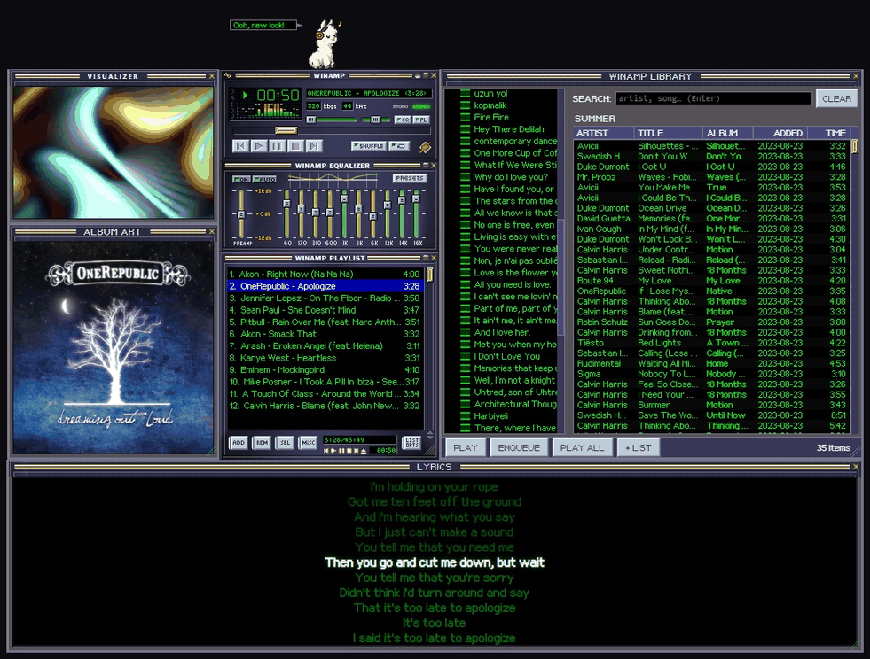
</p>

> **Premium** streams directly (playback via
> [librespot](https://github.com/librespot-org/librespot)); **Free** accounts get
> **Free Mode**, where Spotiamp+ becomes the Winamp face of the official Spotify
> app and drives it. Login always uses Spotify's own page.

## Highlights

- 🎵 Your Spotify playlists, favorite songs and the whole catalogue, in Winamp's windows
- 💿 Your own music files and folders, mixed into the same playlist
- 📻 Thousands of internet radio stations, in full quality
- 🎨 Any classic Winamp skin, from the built-in Skin Museum or a `.wsz` file
- 🎆 MilkDrop with 534 presets, plus 100 more visualizer patterns
- 🎤 Synced lyrics, album art and a real 10-band equalizer
- 🦙 Lala, a little llama who lives on your player
- 🎧 Last.fm scrobbling, Discord presence, listening stats and badges

## 🎵 Music

**Spotify.** Premium plays natively (Ogg 320 kbps, gapless). The **Library**
window has your playlists, *Favorite Songs* (your Liked Songs), *Recently played* and *Most played*
(kept on your own computer), and a search of the whole catalogue:
double-click a result to add it to the end of the playlist, and build a list one
song after another. Pin your favourite playlists to the top, drag songs or whole
lists onto the playlist, press **F** to love a song, **Q** to play the selected
one next, **J** to jump to a song by name, and right-click for an *Instant mix*
of 20 songs like it. Spotiamp+ picks up where you left off, and reconnects by
itself if Spotify drops the session.

**Your own files.** MP3, FLAC, M4A (AAC or Apple Lossless), WAV and OGG play
right alongside Spotify, through the same EQ and visualizers, with their own
tags, kbps and kHz. Add files or a folder (**O** / **Shift+O**), or **drag them
from Windows Explorer**: onto the playlist to add them, onto the main window to
play them. Add your music folders to **Local Media** in the Library
(right-click it → *Add a folder…*) and every song in them is listed with its
artist, album and length: sort it, filter it as you type, play it or drag it
into the playlist. New files show up by themselves, and tens of thousands of
songs scroll as smoothly as ten. In Free Mode too.

**Internet radio.** The Library's *Radio*: search thousands of stations by
name or genre, see the most listened ones (everywhere, or in your country), and
find the ones you've played under *Your stations*. Only stations that really
play are listed. **Ctrl+L** (or *Playlist → Open a link…*) takes any station's
link (SHOUTcast, Icecast, HLS, a `.pls` or an `.m3u`) or a Spotify song, album
or playlist. Stations play in full quality (HE-AAC / AAC+ too), through the EQ
and the visualizers, with the name of the song they're on, and one that drops
is connected again.

| Local Media | Radio |
| :---------: | :---: |
| 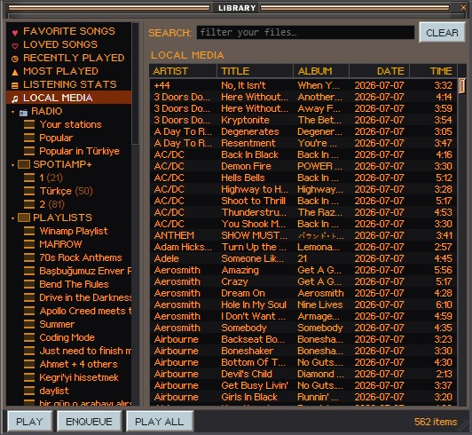 | 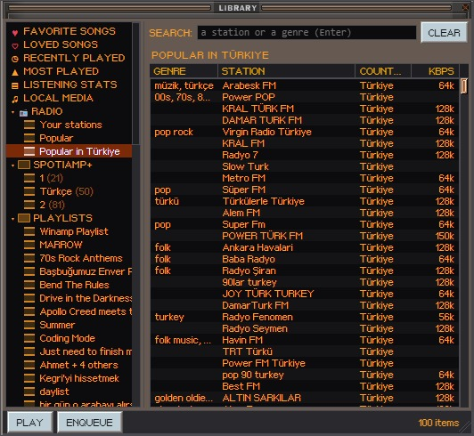 |

**Last.fm.** Right-click → *Last.fm* → *Connect your Last.fm…*, allow
Spotiamp+ on Last.fm's page, and what you play is scrobbled (once half the song,
or 4 minutes, has played; a song on repeat counts every time). Without internet
the scrobbles wait and go later.

## 🎨 Skins

Right-click → *Skins* to switch live: **Classic**, **Cherry**, **Amber** and
**Emerald**, **Spotiamp+** (our own, in the logo's orange and amber) and six
bundled classic Winamp skins: the *Classified* series by
[Victhor](https://victhor.deviantart.com/) and the Sony / Nucleo hardware-style
skins (all rights remain with their original authors). The **Skin Museum**
opens right inside Spotiamp+ (*Skins → Skin Museum…*): browse thousands of
skins from the [Winamp Skin Museum](https://skins.webamp.org/), put one on with
a click and star your favourites. Or load any Winamp 2.x skin (`.wsz`) from
disk.

Skins come the full Winamp way, on every window, the Library too: their own
**mouse cursors**, **window shapes**, **titlebars with the title in the skin's
own letters**, the visualizer's colours and, if you like, the skin's font
(*Skins → Use the skin's font*).

| Spotiamp+ | Bento Classified | Winamp3 Classified | Winamp5 Classified |
| :-------: | :--------------: | :----------------: | :----------------: |
| 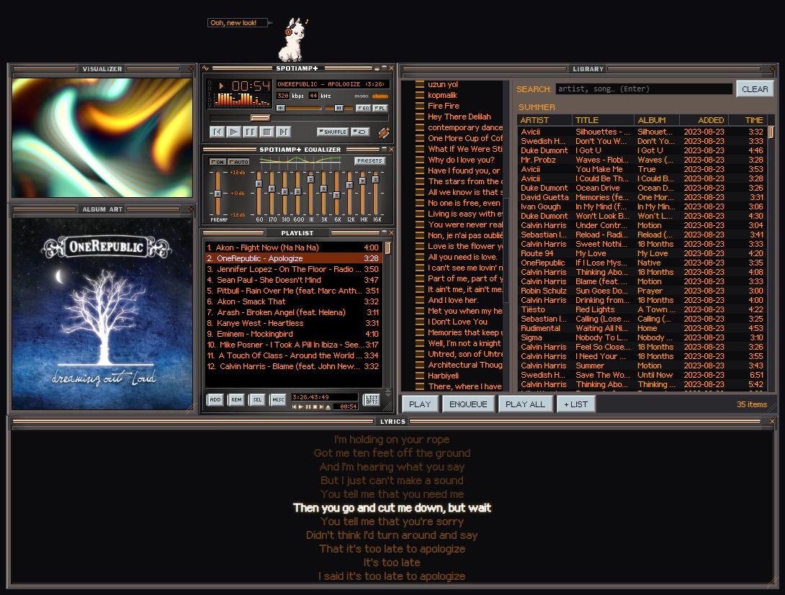 | 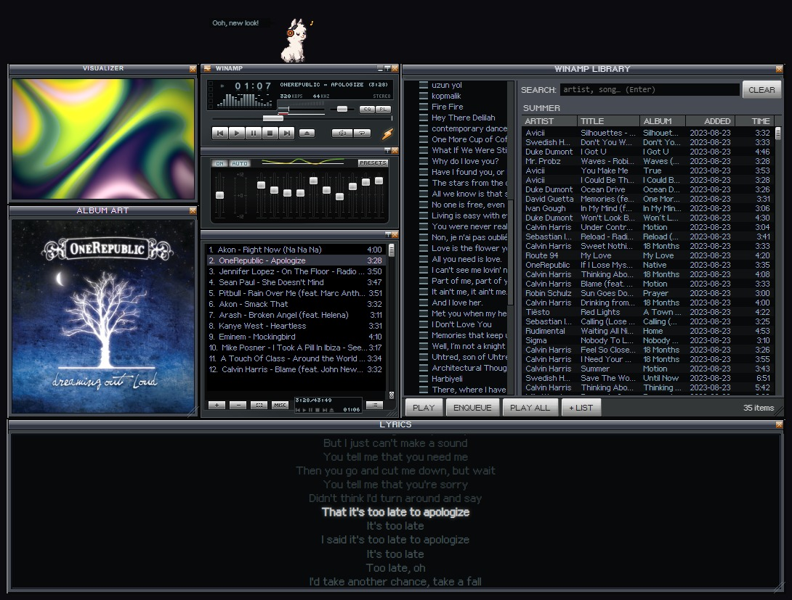 | 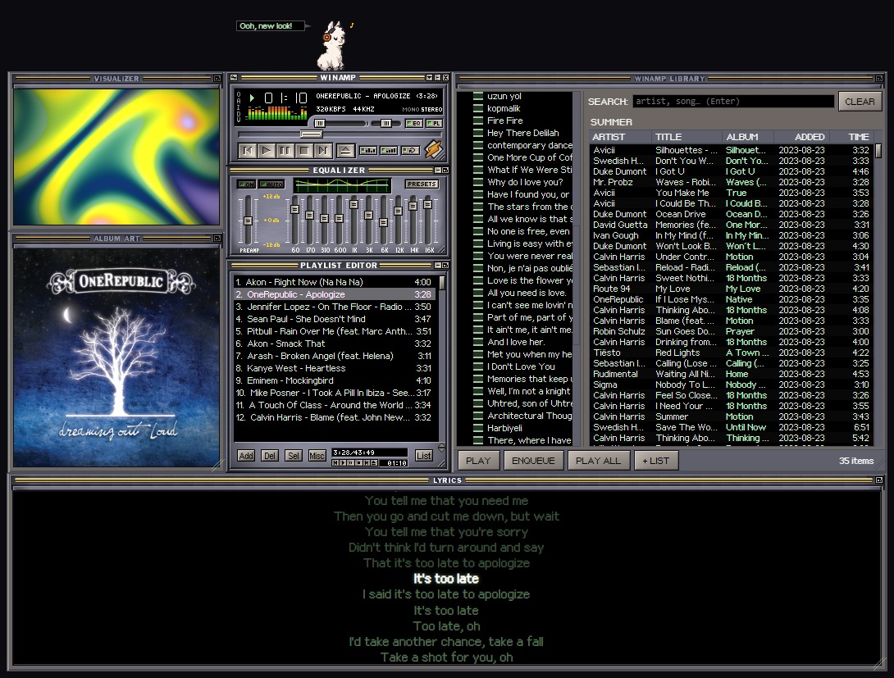 | 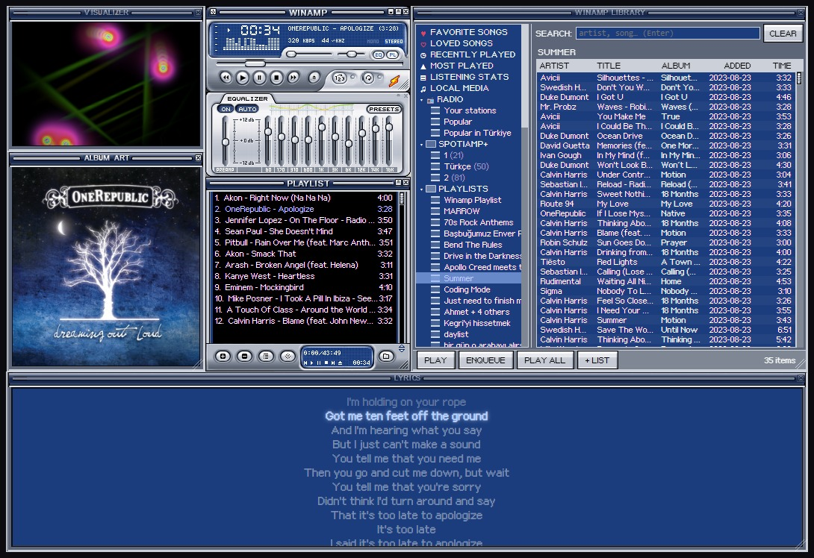 |

| Nucleo NLog | Sony CDX-MP3 | Sony Esprit V2 | Classic |
| :---------: | :----------: | :------------: | :-----: |
|  |  |  | 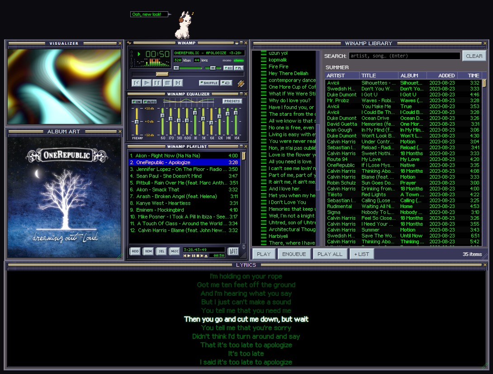 |

### Classic in colour

Classic also comes in three colours of its own:

| Cherry | Amber | Emerald |
| :----: | :---: | :-----: |
| 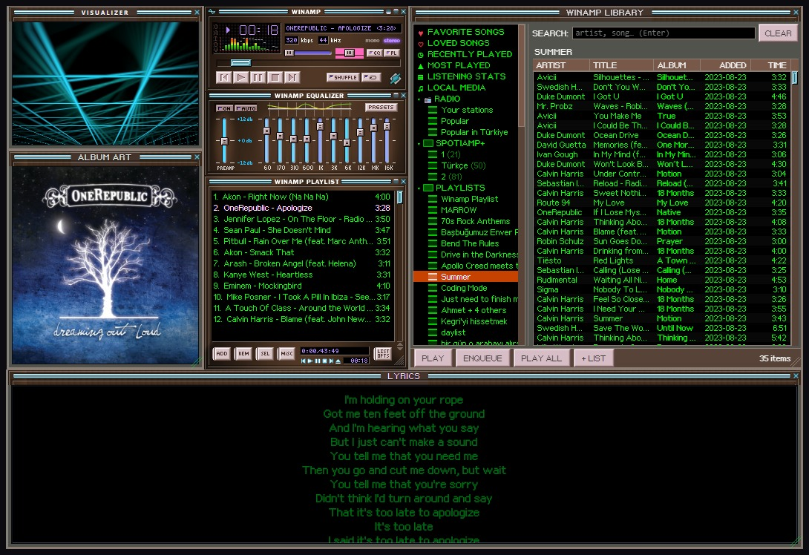 | 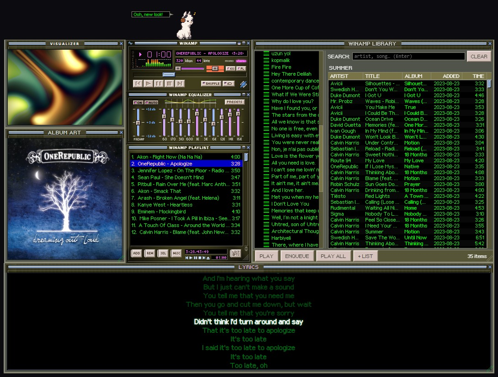 | 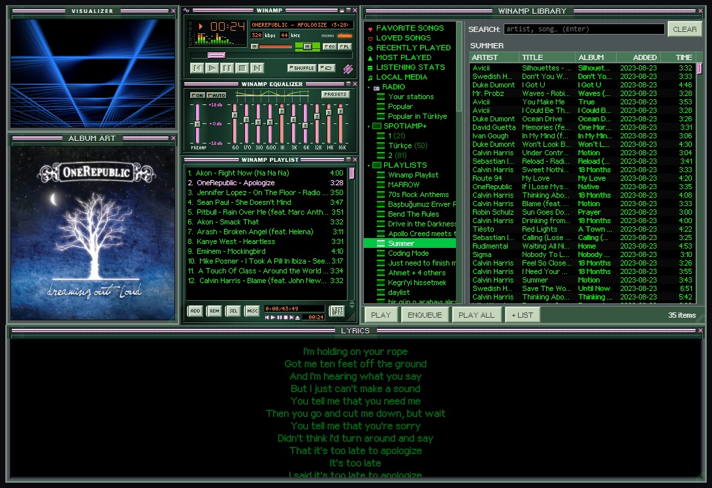 |

## 🎆 Visualizers

- **MilkDrop**: real MilkDrop presets drawn by
  [projectM](https://github.com/projectM-visualizer/projectm), moving with the
  music. **534 presets** come with it, 183 of them by **Incubo_**
  (Se7enSlasher), and presets made for his BeatDrop work too. Press **M** in
  the visualizer to switch it on, **L** for the preset list (search it, ♥ your
  favourites), click for the next one, PIN to keep one, double-click for
  fullscreen. Your own `.milk` files and textures have a folder of their own.
- **100 more patterns** in the visualizer window: spectrum analysers, VU
  meters, a spectrogram, synthwave, a spinning record and more, changing on
  click, on a timer or with every song.
- The main window's **spectrum and oscilloscope**, like Winamp's, in the skin's
  own colours: right-click for the Fire and Line styles, bands and peaks.

| MilkDrop, moving with the music | Four of its presets |
| :-----------------------------: | :-----------------: |
|  | 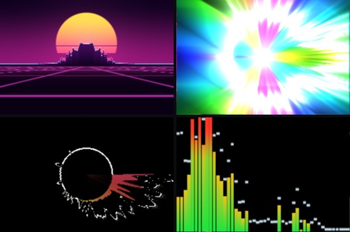 |

## 🦙 Meet Lala

<p align="center">
  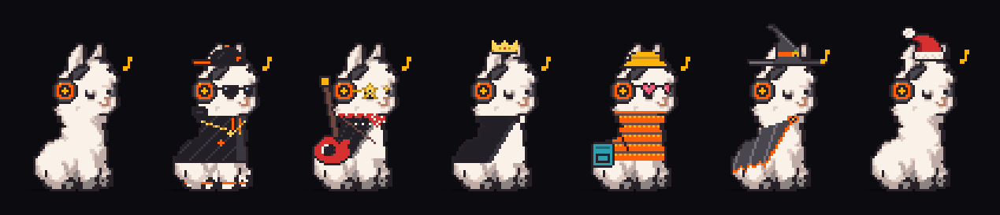
</p>

A little llama who lives on your player. She dances to the beat, naps when the
music stops, wakes up when you pat her, says something now and then (a fact
about the song, your listening streak, a tip) and wanders over to your other
windows when she's bored. Drag her along the edge, double-click her for a
stroll, right-click her for her size, to quiet her or to hide her.

**Dress her up**: 20 outfits in her wardrobe, from sneakers and caps to a
hoodie, a guitar and a crown, each opened by one of your listening badges
(*Listening stats → WARDROBE*). On Halloween she's a little witch, and over the
New Year she wears a Santa hat.

## 🎚️ Lyrics, album art, EQ and stats

- **Lyrics**: synced lyrics that follow the song; click a line to jump there.
- **Album art**: the cover in its own window, docked like the others.
- **10-band equalizer**: Winamp's EQ window with a real DSP behind it, preamp,
  presets, `.EQF` files (yours or Winamp's), and **AUTO**: a curve saved for a
  song or an artist comes back whenever they play. Plus a balance slider.
- **Listening stats**: time listened, top songs and artists, your streak and
  when you listen, **48 badges** to unlock, a picture to share, and every
  December, **Rewind** looks back on your year.

| Equalizer | Album art | Visualizer |
| :-------: | :-------: | :--------: |
| 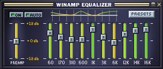 | 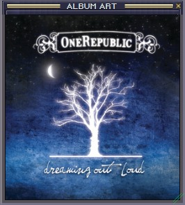 | 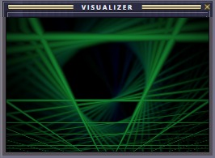 |

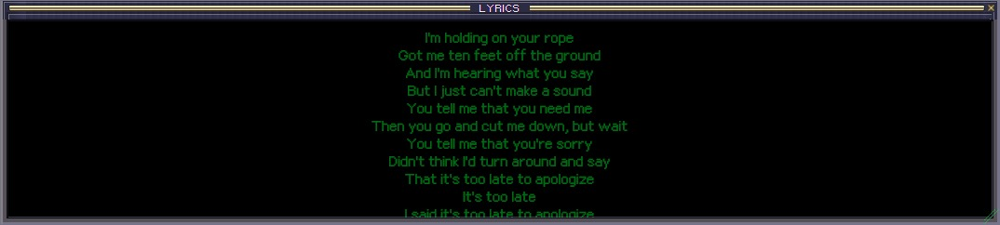

<details>
<summary><b>✨ Everything else</b></summary>

- 🧲 **Docking windows** that snap to the main window and move together, and
  **windowshade mode** to roll any window up to a strip
- 🔍 **Scale**: every window at 1×, 1.5×, 2× or 3× (**Ctrl+D** for 2×), crisp at
  any Windows display scaling
- ⏹️ **Stop after current** (**Ctrl+V**) and **jump to a time** (**Ctrl+J**)
- 🔀 Shuffle and repeat (off / all / one); no song listed twice
- 📄 Open and save **`.m3u` playlists**: local files, Spotify songs and radio
  stations, in order
- 🖱️ **Song menus**: right-click a song to play it next, love it, add it to a
  list, copy its link or show a file in its folder
- 🔊 **Normalize volume** and pick the **output device** (right-click → *Audio*)
- 💬 **On-screen display** with the new song and its cover (optional)
- 📌 **Taskbar extras**: the song on the taskbar button, progress across it and
  ⏮ ⏯ ⏭ under its thumbnail (optional)
- 🖼️ **Now Playing card**: an image of the player and the song, ready to paste
- 😴 **Sleep timer**: pause after 15, 30, 45 or 60 minutes
- 🎛️ **Media keys** and headset buttons, even with Spotiamp+ in the background
- 🎮 **Discord Rich Presence**: the song, its cover and a live progress bar (a
  radio station shows as radio)
- 🪟 Your **window layout** comes back the way you left it
- 🔄 **Built-in updater** (signed), and a *What's new* window after each update
- 🩺 **Copy diagnostic info** for a bug report (right-click → *Help*)

</details>

## Install

1. Download the latest installer from the [**Releases**](../../releases/latest) page.
2. Run it. Windows SmartScreen may warn because the build is unsigned: choose
   **More info → Run anyway**.
3. Launch Spotiamp+ and log in with your Spotify account: **Premium** streams
   directly, **Free** gets Free Mode.

From then on, right-click → *Help → Check for updates* keeps you current.
Windows 10/11 (x64) only for now.

<details>
<summary><b>⌨️ Keyboard shortcuts</b></summary>

These work in the main window **and every other window**. In the Library,
typing searches instead, so there only `Ctrl+D`, `Ctrl+V`, `Ctrl+J`, `Ctrl+L`
and `F1` work. The right-click menu shows each key next to what it does, and
**`F1`** opens the whole list.

| Key | Action | Key | Action |
| --- | --- | --- | --- |
| `Z` `X` `C` `V` `B` | prev / play / pause / stop / next | `Space` | play–pause |
| `↑` `↓` / mouse wheel | volume | `←` `→` | seek ∓5s |
| `S` | shuffle | `R` | repeat (off / all / one) |
| `J` | jump to a track | `Q` | play the selected track next |
| `F` | love the song ♡ | `Ctrl+V` | stop after the current song |
| `L` | open Library | `O` / `Shift+O` | add local file(s) / folder |
| `Ctrl+D` | everything 2× bigger | `F1` | all the keyboard shortcuts |
| `Ctrl+J` | jump to a time in the song | `Ctrl+L` | open a Spotify link or a radio station |

**Playlist window:** `Ctrl+A` selects all, `Delete` removes, `Enter` plays,
`↑` `↓` move the selection (`Shift` extends it, `Alt+↑/↓` reorders). Letters are
shortcuts there, so press **`J`** and type part of a song's name to find it.

**Library window:** start typing to jump to the first track that matches.

**Visualizer:** click to change the pattern, double-click for fullscreen, `Esc`
to come back. `M` switches MilkDrop on and off; with it on, `L` opens the
preset list.

</details>

<details>
<summary><b>🛠️ Build from source</b></summary>

Requires Rust (stable), Node.js, and the platform toolchain for
[Tauri 2](https://v2.tauri.app/start/prerequisites/) (on Windows: VS C++ Build
Tools + WebView2).

```bash
npm install
npm run tauri dev      # run in development
npm run tauri build    # produce a release installer (src-tauri/target/release/bundle)
```

</details>

---

<sub>[MIT License](LICENSE) (Lala's art and animations: © fdeox, all rights reserved, see [their license](src/lib/mascot/LICENSE.md)) · [Privacy](PRIVACY.md) · based on [tedsteen/Spotiamp](https://github.com/tedsteen/Spotiamp) · MilkDrop by [projectM](https://github.com/projectM-visualizer/projectm) (LGPL-2.1), presets and textures by their authors ([credits](src-tauri/presets/CREDITS.txt)) · AAC decoding by [rusty_aac](https://crates.io/crates/rusty_aac) (Apache-2.0) · not affiliated with Winamp or Spotify</sub>
